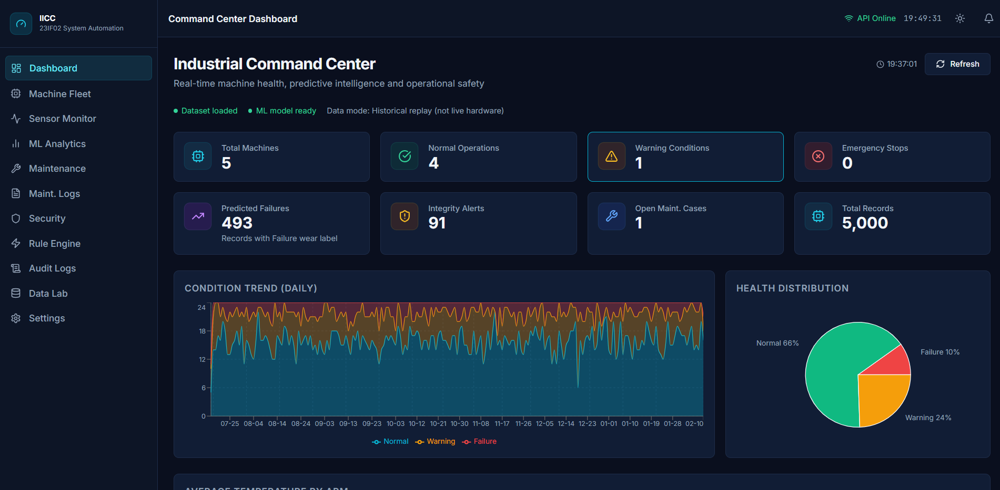
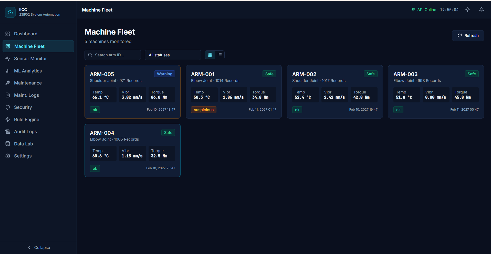
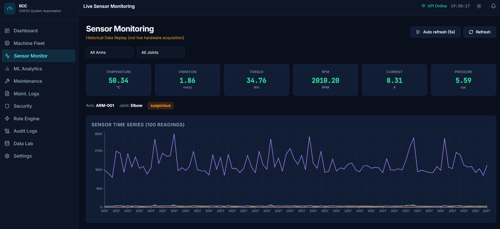
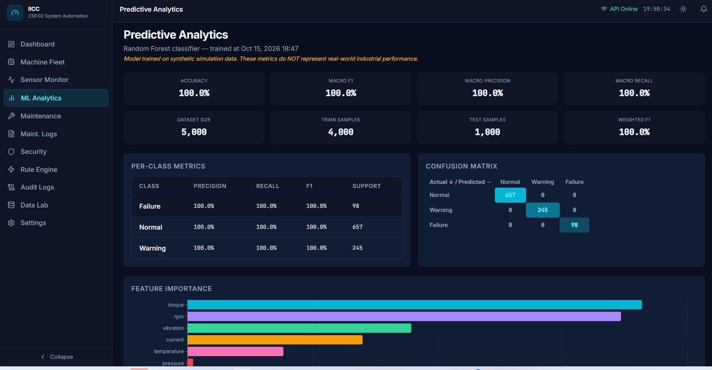
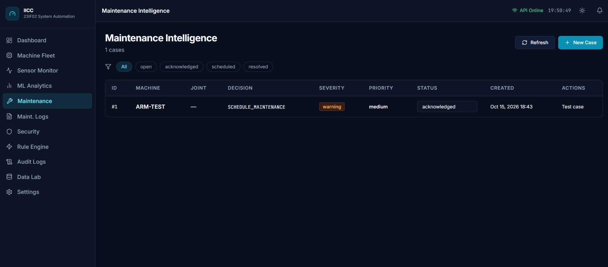
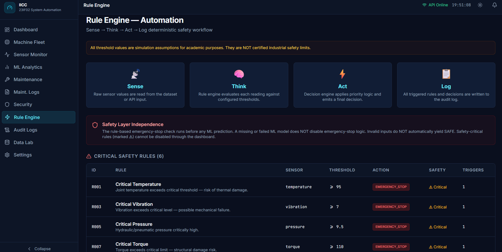
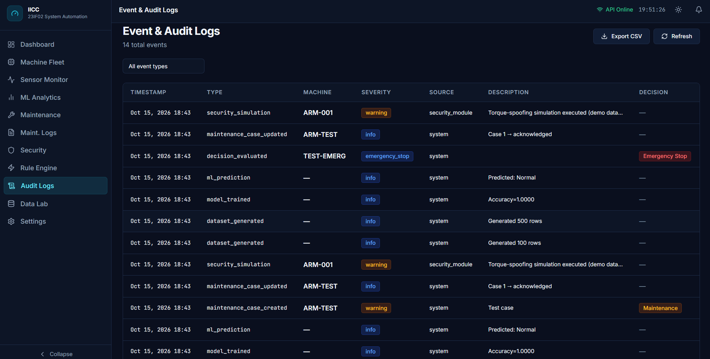
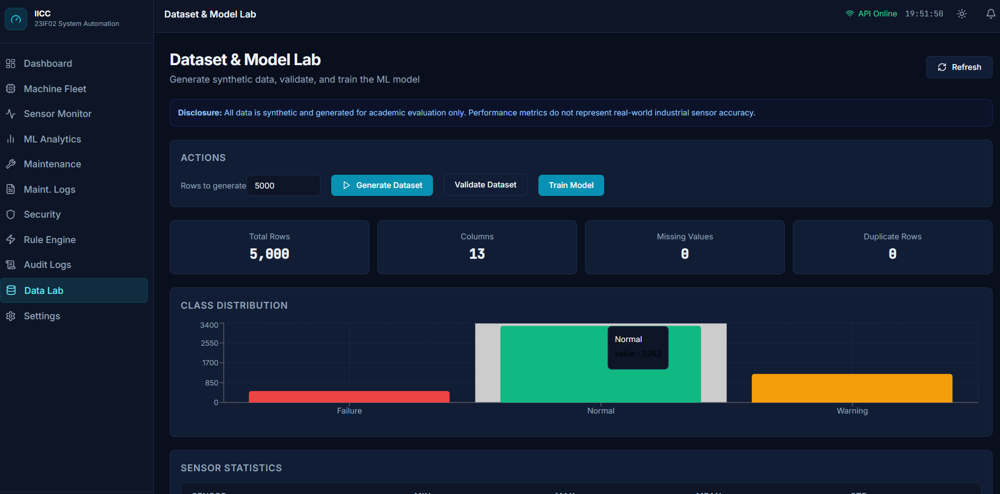

# Industrial Intelligence Command Center (IICC)

**Course:** 23IF02 — System Automation  
**Project:** Intelligent Industrial Sensor Monitoring & Predictive Maintenance  
**Repository:** https://github.com/Ajay21-03/System-automation-PSG-23i204.git

---

## What This Project Does

IICC is a full-stack industrial monitoring platform that:

- Monitors 5 robotic arms across 3 joints (shoulder, elbow, wrist)
- Applies a **deterministic rule-based safety engine** (Sense → Think → Act → Log)
- Trains a **Random Forest ML model** to predict wear conditions
- Detects **sensor spoofing and integrity anomalies**
- Analyzes **maintenance log notes** with keyword-based NLP
- Produces a **single final decision** per machine: `SAFE / MONITOR / SCHEDULE_MAINTENANCE / EMERGENCY_STOP`

---

## Screenshots

### 1. Command Center Dashboard
> The main landing page showing real-time KPI cards, daily condition trend chart (Normal / Warning / Failure stacked area), health distribution pie chart, and API/model status indicators. All metrics are calculated from actual backend data — 5 machines monitored, 5,000 sensor records, 493 predicted failures, 91 integrity alerts.



---

### 2. Machine Fleet
> Grid view of all 5 robotic arms with live status badges (Safe / Warning / Emergency Stop), key sensor readings (Temperature, Vibration, Torque), sensor integrity status, and last reading timestamp. ARM-005 is flagged as **Warning** and ARM-001 shows a **suspicious** integrity status. Click any card to drill into the machine detail view.



---

### 3. Live Sensor Monitoring
> Real-time sensor panel for ARM-001 (Elbow joint) showing the 6 sensor metrics as live tiles with colour-coded severity states. The time-series chart plots 100 consecutive readings. Clearly labelled as **Historical Data Replay** — not live hardware acquisition. Supports arm/joint filters and an auto-refresh mode (5-second interval).



---

### 4. Predictive Analytics (ML Model)
> Full ML analytics workspace: Random Forest classifier trained on 5,000 synthetic records. Shows accuracy, macro F1, macro precision, macro recall, per-class metrics table, confusion matrix with diagonal highlighting, and a horizontal feature-importance bar chart. Torque and RPM are the top predictive features. Disclosure banner confirms this is synthetic-data evaluation only.



---

### 5. Maintenance Intelligence
> Maintenance case tracker with filter tabs (All / Open / Acknowledged / Scheduled / Resolved). Each case shows machine ID, joint, decision type, severity badge, priority, and an inline status dropdown for real-time updates. Cases are deduplicated — no duplicates generated on page refresh.



---

### 6. Rule Engine — Automation
> The Sense → Think → Act → Log workflow visualised as four step cards. Below, all 6 critical safety rules are listed with sensor name, threshold operator, EMERGENCY_STOP action badge, and live trigger count. A red safety-layer independence notice explains that emergency-stop logic runs before ML and cannot be overridden by the dashboard.



---

### 7. Event & Audit Logs
> Searchable, paginated audit log showing 14 structured events: security simulations, maintenance case updates, decision evaluations (with Emergency Stop badge), ML predictions, model training, and dataset generation. Supports event-type filter and one-click CSV export.



---

### 8. Dataset & Model Lab
> Data management workspace: generate up to 50,000 synthetic rows, validate the schema, and train the model — all from a single panel. Shows total rows (5,000), 13 columns, 0 missing values, 0 duplicates. Class distribution bar chart confirms the realistic imbalance: ~3,283 Normal, ~1,224 Warning, ~493 Failure.



---

> **Note:** To add screenshots, save your PNG images to `docs/screenshots/` with the filenames shown above (e.g. `01_dashboard.png`, `02_fleet.png`, ..., `08_data_lab.png`). GitHub will render them automatically.

---

## Quick Start (Windows PowerShell)

### 1 — Open the project directory

```powershell
cd "D:\Downloads\FinalAssigment(oneCredit)"
```

### 2 — Set up Python backend

```powershell
cd backend
python -m venv venv
.\venv\Scripts\Activate.ps1
pip install flask flask-cors scikit-learn joblib pytest pytest-cov python-dateutil pandas numpy
```

### 3 — Bootstrap: generate dataset + train model

```powershell
python scripts\bootstrap.py
```

Expected output:
```
Database initialised.
Generating 5,000-row dataset...
Saved: 5000 rows -> ...\data\sensor_data.csv
Class distribution: {'Normal': 3283, 'Warning': 1224, 'Failure': 493}
Validation passed: True
  [OK] row_count: Expected 5000, found 5000
  ... (all checks pass)
Model trained!
  Accuracy: 1.0000   (synthetic data)
  Macro F1: 1.0000
```

### 4 — Start the Flask backend

```powershell
python run.py
```

Backend runs at: **http://localhost:5000**

### 5 — Install and start the frontend (new terminal)

```powershell
cd ..\frontend
npm install
npm run dev
```

Frontend runs at: **http://localhost:5173**

### 6 — Open the app

Open your browser and go to: **http://localhost:5173**

---

## Running Tests

```powershell
cd backend
.\venv\Scripts\Activate.ps1
python -m pytest tests/ -v
```

Expected: **56 passed**

---

## Project Structure

```
FinalAssigment(oneCredit)/
├── backend/
│   ├── app/
│   │   ├── __init__.py          # Flask app factory + CORS
│   │   ├── routes/              # 14 API blueprints
│   │   ├── services/
│   │   │   ├── dataset_generator.py   # 5,000-row synthetic data
│   │   │   ├── dataset_validator.py   # Schema + range validation
│   │   │   ├── rule_engine.py         # Day-1/2 Sense→Think→Act→Log
│   │   │   ├── ml_service.py          # Random Forest training + predict
│   │   │   ├── nlp_service.py         # Maintenance log keyword NLP
│   │   │   ├── integrity_service.py   # Spoofing + anomaly detection
│   │   │   ├── decision_engine.py     # Final 4-outcome decision
│   │   │   └── persistence.py         # SQLite maintenance/audit store
│   │   └── utils/
│   │       ├── config.py        # Thresholds, paths, constants
│   │       ├── response.py      # Consistent JSON responses
│   │       └── audit.py         # Structured JSONL event logger
│   ├── data/
│   │   └── maintenance_log.txt  # 10 sample maintenance notes
│   ├── models_ml/               # Saved model + metrics (generated)
│   ├── scripts/
│   │   └── bootstrap.py         # One-command setup
│   ├── tests/                   # 56 pytest tests
│   ├── requirements.txt
│   └── run.py
│
├── frontend/
│   ├── src/
│   │   ├── pages/               # 12 full pages
│   │   │   ├── Dashboard.tsx
│   │   │   ├── Fleet.tsx
│   │   │   ├── MachineDetail.tsx
│   │   │   ├── Monitoring.tsx
│   │   │   ├── Analytics.tsx
│   │   │   ├── Maintenance.tsx
│   │   │   ├── MaintenanceLogs.tsx
│   │   │   ├── Security.tsx
│   │   │   ├── Automation.tsx
│   │   │   ├── Logs.tsx
│   │   │   ├── DataLab.tsx
│   │   │   └── Settings.tsx
│   │   ├── components/
│   │   │   ├── layout/          # AppShell, Sidebar, TopBar
│   │   │   └── ui/              # KpiCard, Badge, Skeleton, etc.
│   │   ├── api/                 # Typed API client + all endpoints
│   │   ├── store/               # Theme context, Toast context
│   │   ├── types/               # Full TypeScript domain types
│   │   └── utils/               # format, severity helpers
│   ├── package.json
│   └── vite.config.ts           # Proxy: /api → http://localhost:5000
│
├── docs/
│   └── screenshots/             # UI screenshots (01–08)
│
└── README.md
```

---

## API Endpoints

| Method | Endpoint | Description |
|--------|----------|-------------|
| GET | `/api/health` | API health check |
| GET | `/api/dashboard/summary` | KPIs and machine statuses |
| GET | `/api/dashboard/trends` | Daily trend series |
| GET | `/api/fleet` | All machines with latest readings |
| GET | `/api/fleet/:armId` | Machine detail + joint breakdown |
| GET | `/api/monitoring/readings` | Sensor time-series (historical replay) |
| GET | `/api/analytics/metrics` | ML model metrics |
| POST | `/api/predict` | ML prediction for sensor values |
| POST | `/api/decisions/evaluate` | Full 4-outcome decision evaluation |
| GET | `/api/decisions/demo` | Demo all 4 decisions |
| GET | `/api/maintenance` | List maintenance cases |
| POST | `/api/maintenance` | Create maintenance case |
| PATCH | `/api/maintenance/:id` | Update case status |
| GET | `/api/maintenance-logs` | List NLP-analyzed log entries |
| POST | `/api/maintenance-logs` | Submit and analyze a note |
| GET | `/api/security/events` | Integrity/security events |
| POST | `/api/security/simulate` | Torque-spoofing demo |
| GET | `/api/automation/rules` | Rule engine rules + stats |
| GET | `/api/logs` | Audit event log |
| GET | `/api/logs/export` | Download audit log as CSV |
| GET | `/api/dataset/summary` | Dataset info + validation |
| POST | `/api/dataset/generate` | Generate synthetic dataset |
| POST | `/api/model/train` | Train Random Forest model |
| GET | `/api/model/status` | Model availability + metrics |
| GET | `/api/system/status` | Full system health |

---

## Decision Priority

```
1. EMERGENCY_STOP  — critical sensor threshold exceeded (rule engine)
2. SCHEDULE_MAINTENANCE — ML predicts Failure OR NLP detects critical issue
3. MONITOR         — warning-level conditions, integrity anomalies
4. SAFE            — all sensors within normal operating parameters
```

**The safety layer is independent of ML. Emergency stop works even when the model is unavailable.**

---

## Dataset Schema (5,000 rows)

| Column | Type | Description |
|--------|------|-------------|
| timestamp | datetime | ISO 8601 UTC |
| arm_id | string | ARM-001 to ARM-005 |
| joint | string | shoulder / elbow / wrist |
| temperature | float | °C |
| pressure | float | bar |
| vibration | float | mm/s RMS |
| rpm | float | Revolutions per minute |
| current | float | Amperes |
| torque | float | Newton-metres |
| status | string | normal / warning / failure |
| wear_label | string | Normal / Warning / Failure (ML target) |
| failure_event | int | 1 if Failure (NOT used as ML feature) |
| sensor_integrity | string | ok / suspicious |

**Class distribution:** ~65% Normal, ~25% Warning, ~10% Failure (realistic imbalance, not forced equal)

---

## Thresholds (Simulation Assumptions Only)

> ⚠️ These are NOT certified industrial safety limits. They are assumptions for a simulated academic environment.

| Sensor | Warning | Critical |
|--------|---------|---------|
| Temperature (°C) | 75 | 95 |
| Pressure (bar) | 7.5 | 9.5 |
| Vibration (mm/s) | 4.5 | 7.0 |
| RPM | 2800 | 3400 |
| Current (A) | 12 | 16 |
| Torque (Nm) | 85 | 110 |

---

## Troubleshooting

**Backend won't start:**
```powershell
# Make sure venv is activated
.\venv\Scripts\Activate.ps1
# Check Python version (need 3.10+)
python --version
```

**Frontend shows "API Offline":**
- Make sure Flask is running on port 5000
- The Vite dev server proxies `/api` → `http://localhost:5000`

**Port 5000 already in use:**
```powershell
# Change port in backend/run.py
app.run(host="0.0.0.0", port=5001, debug=True)
# Update vite.config.ts proxy target to match
```

**Dataset or model missing:**
```powershell
cd backend
python scripts\bootstrap.py
```

---

## Git Submission

```powershell
cd "D:\Downloads\FinalAssigment(oneCredit)"
git add docs/screenshots/
git commit -m "docs: add UI screenshots to README"
git push -u origin master
```

---

## Disclosures

- All sensor data is **synthetically generated** for academic purposes.
- ML accuracy of 100% reflects the synthetic dataset structure, not real-world performance.
- Sensor thresholds are **simulation assumptions**, not certified engineering limits.
- The NLP module uses **keyword matching**, not a trained language model.
- The security module detects **basic anomalies** only; it is not a certified cybersecurity solution.
- Data mode is **historical replay** — there is no live hardware connection.
